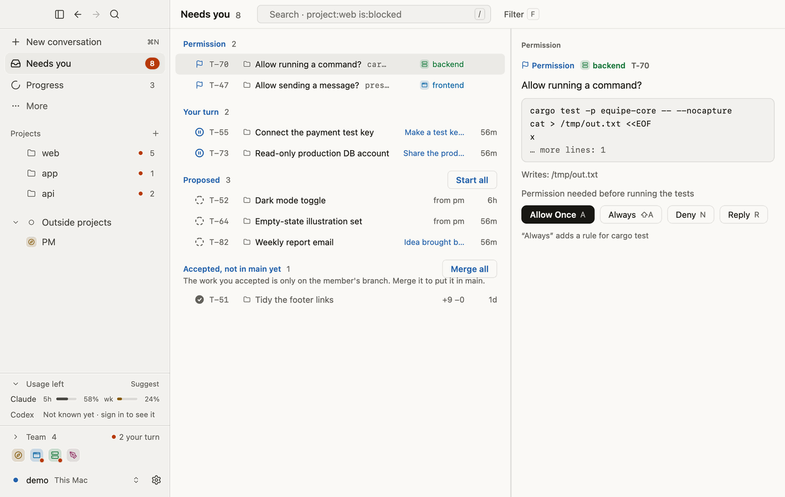
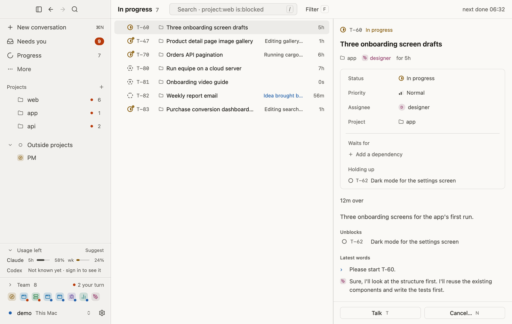
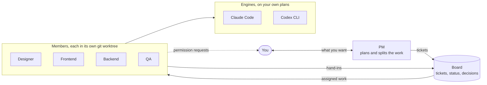

# equipe

**A squad of AI coding agents that you lead.** A PM, a designer, frontend and
backend engineers, QA and more work together on your projects, on top of Claude
Code or Codex with your own plan. The PM turns what you ask for into tickets,
members build them on their own branches, and the decisions that matter stay
yours.

[](https://github.com/equipe-labs/equipe/actions/workflows/ci.yml)
[](https://github.com/equipe-labs/equipe/releases/latest)
[](LICENSE)

<picture>
  <source media="(prefers-color-scheme: dark)" srcset="docs/images/readme/needs-you-dark.png">
  
</picture>

<sub>The desktop app's **Needs you** view: what the squad is waiting on you for. Example data from the repository's
test daemon.</sub>

[Quick start](#quick-start) · [How it works](#how-it-works) · [Safety and privacy](#safety-and-privacy) ·
[Documentation](#documentation) · [Contributing](#contributing)

## Why equipe

One coding agent in a chat window is good at one task. A real project needs more: someone who
owns the plan, work that runs in parallel without collisions, review before anything lands,
and one clear place where you say yes or no.

equipe is that team layer. It does not rebuild the agent loop. It drives mature coding agents
(Claude Code and the Codex CLI) and adds roles, a shared board, isolated git worktrees, and
approval gates.

## What it does

- **One conversation with the PM.** Say what you want. The PM answers what's quick and puts
  the rest on the board as tickets, then hands each one to the right member.
- **Parallel work that doesn't collide.** Each member works in its own git worktree, on its own
  branch. Your checkout is not touched.
- **Roles you choose.** PM, designer, frontend, backend, mobile, QA, security, marketing and
  data, plus roles of your own (`/add custom <name>`). equipe never adds a member without your
  yes. Each role keeps a memory that every member of that role shares.
- **Engines per member.** Mix Claude Code and Codex in one squad, and change a member's model
  with `/model`. Members can also run on open models through the Codex CLI with your own key
  ([OPEN-MODELS.md](docs/OPEN-MODELS.md)).
- **Not only code.** Research, writing and other tasks go on the board as tickets too, and are
  reviewed the same way.
- **Keeps working when you leave.** The squad lives in a background daemon. Come back from
  the desktop app (macOS), the terminal console (macOS and Linux), or Telegram. The desktop
  app can also open a squad that runs on another machine, over SSH.
- **Speaks your language.** The interface is in English, German, Spanish, French, Japanese,
  Korean, and Simplified and Traditional Chinese.

<picture>
  <source media="(prefers-color-scheme: dark)" srcset="docs/images/readme/in-progress-dark.png">
  
</picture>

<sub>Work in progress across a squad of eight. Example data from the repository's test daemon.</sub>

## Quick start

You need **git** and at least one engine signed in: [Claude Code](https://code.claude.com/docs/en/setup)
on your Claude plan, or Codex on your ChatGPT plan.

### macOS: the desktop app

Download [equipe.dmg](https://github.com/equipe-labs/equipe/releases/latest/download/equipe.dmg),
drag equipe to Applications and open it. The first window walks you through setup: it
installs Apple's developer tools if git is missing, lets you pick a project folder (or none)
and name your squad, then opens **Settings → AI platforms**, where you can install Claude Code
or Codex with its maker's own installer and sign in. The app starts the daemon for you.

### macOS and Linux: the terminal

```bash
curl -fsSL https://github.com/equipe-labs/equipe/releases/latest/download/install.sh | sh
```

This installs a prebuilt `equipe` into `~/.local/bin`, checked against its SHA-256. Or use
Homebrew:

```bash
brew install equipe-labs/tap/equipe
```

Sign in to an engine and check it's ready:

```bash
equipe login        # pick Claude Code or Codex
equipe status       # which engines are ready, on which plan
```

Then open the squad console from your project (or any folder):

```bash
cd your-project
equipe
```

The first run sets up your squad; no repository is needed. Tell the PM what you want, for
example *"Add a dark mode toggle to the settings page"*, and watch the tickets appear. When a
member asks for permission, press `y` to allow it once, `A` to always allow it, or `n` to
decline. Work that waits for your review can be accepted with `/accept` or sent back with
`/reopen`.

Update with `equipe update` (or `brew upgrade equipe`). The full command reference is in
[docs/USAGE.md](docs/USAGE.md).

<details>
<summary>Build from source</summary>

Needs a stable [Rust](https://rustup.rs) toolchain and git.

```bash
git clone https://github.com/equipe-labs/equipe && cd equipe
cargo install --locked --path crates/cli
```

</details>

## How it works



1. **You talk to the PM** (or to any member directly with `@name`).
2. **The PM writes tickets** on the board, the single source of truth. Members coordinate
   through tickets and their history, not through free-form chat.
3. **A member takes a ticket** and works on its own branch, in its own worktree, inside a
   sandbox. Anything beyond the sandbox, such as a push or a deploy, waits for your answer.
4. **The member hands the work in** for review: the branch's diff for code, and for other
   work the files it left and the sources it cited.
5. **The work is accepted.** By default the PM checks and accepts routine work, and brings you
   anything that can't easily be undone or reaches outside: production deploys, live data,
   money, security and permissions, what customers will see, and brand direction. Turn this off
   in **Settings → Team → The PM accepts work** and you accept every ticket yourself. When
   the project declares its checks in `.equipe/checks.json`, equipe runs them on the work
   merged with main before the PM's acceptance lands, and sends failing work back to its
   member ([docs/USAGE.md](docs/USAGE.md#project-checks)).

More in [docs/ARCHITECTURE.md](docs/ARCHITECTURE.md).

## Safety and privacy

**Approvals are yours.** Answering a permission request, accepting or merging work, and
approving changes to the team are commands only the person can send. The daemon refuses them
when they come from a member's own process, whatever its mode or engine
([`person_only`](crates/core/src/permissions.rs) and [`gateway.rs`](crates/core/src/gateway.rs)).
From a phone, a permission can be allowed once, never "always".

**Permission modes.** Each member works in one of four modes (`/mode` in the console):

| Mode | What the member may do |
|---|---|
| read-only | Reads and plans. Changes nothing. |
| ask me | Asks you before every edit and every command. |
| **auto** (default) | Edits, installs, builds and tests on its own, sandboxed in its worktree. Asks before anything beyond: network, pushes, your accounts. |
| full access | Does anything your account can without asking, except what equipe always blocks. Still asks before acting in your name. Because it runs with your account's rights, equipe can't fully stop a determined member here; auto is the safer default. |

**The sandbox.** In auto, a member's shell commands run inside its engine's operating-system
sandbox (Claude Code's sandbox, Codex's `workspace-write`). They write only inside the member's
worktree and reach only package registries and source hosts (npm, PyPI, crates.io, the Go
proxy, RubyGems, Maven Central, GitHub). Pushing, publishing and deploying (`git push`,
`npm publish`, `gh`, `vercel` and others) ask you even when the sandbox would allow them.
Reading credential locations (`~/.ssh`, `~/.aws`, `.env` files, keychains and others) asks you
every time.

**Always blocked**, in every mode: `sudo`, `su`, `rm -rf /` and `rm -rf ~`, `mkfs`, `dd if=`,
`shutdown`, `reboot` and force pushes. The lists are in
[`crates/core/src/permissions.rs`](crates/core/src/permissions.rs).

**Your credentials.** equipe runs your installed, unmodified `claude` and never reads, stores
or forwards Claude credentials. For Codex, equipe signs in with OAuth on your ChatGPT plan and
identifies itself as a third-party tool. API keys you save are stored on your machine,
readable only by you.

**What leaves your machine.** The daemon and its state (squads, board, memory) live on the
machine that runs it. Network traffic comes from:

| Source | When |
|---|---|
| The engines | Always. Claude Code and Codex talk to their providers as they normally do, or to the model server you configured. |
| Usage telemetry | Only after you say yes. Anonymous events, never content, names or paths. The full list is in [docs/TELEMETRY.md](docs/TELEMETRY.md); `equipe telemetry off` stops it. |
| Update checks | The desktop app checks GitHub Releases for new versions. |
| Features you turn on | Telegram (`equipe telegram setup`), phone pairing through the equipe relay (end-to-end sealed; the relay can't read it), the Nemotron code review (sends the diff to Nebius Token Factory), and the shared Chrome that members use for the sites you sign it in to. |

## Requirements

| | |
|---|---|
| **Desktop app** | macOS 12 or later, Apple silicon or Intel |
| **CLI and daemon** | macOS (Apple silicon, Intel) or Linux (x86_64, arm64). No native Windows build; the installer suggests WSL. |
| **Tools** | git |
| **An engine** | [Claude Code](https://code.claude.com/docs/en/setup) on your Claude plan, Codex on your ChatGPT plan (`equipe login codex`), or an API key for an OpenAI-compatible model server used through the [Codex CLI](https://github.com/openai/codex) |
| **Optional** | Google Chrome and Node.js for the shared browser (`equipe browser`) |

Your plan's usage limits apply. A whole squad on one subscription will reach them sooner than
one person does, so give the busiest roles to the plan with the most room.

## Documentation

| | |
|---|---|
| [docs/USAGE.md](docs/USAGE.md) | Every command and console feature, and how engines sign in |
| [docs/ARCHITECTURE.md](docs/ARCHITECTURE.md) | Design decisions and the shape of the code |
| [docs/OPEN-MODELS.md](docs/OPEN-MODELS.md) | Members on open models (NVIDIA Nemotron, OpenAI-compatible servers) and the Nemotron code review |
| [docs/DESKTOP.md](docs/DESKTOP.md) | The desktop app, including connecting to a daemon over SSH |
| [docs/DESKTOP-CONTROL.md](docs/DESKTOP-CONTROL.md) | Members working macOS desktop apps (experimental) |
| [docs/TELEMETRY.md](docs/TELEMETRY.md) | Exactly what opt-in telemetry sends |
| [docs/remote-protocol.md](docs/remote-protocol.md) | How a phone reaches the daemon through the relay |
| [docs/ROADMAP.md](docs/ROADMAP.md) | What is built and what is next |
| [docs/RELEASING.md](docs/RELEASING.md) | How releases are cut, including the fast path |

## Contributing

Issues and pull requests are welcome on
[GitHub](https://github.com/equipe-labs/equipe/issues). Read [CONTRIBUTING.md](CONTRIBUTING.md)
first: open an issue before a large change so we can agree on the approach. Everyone taking
part follows the [Code of Conduct](CODE_OF_CONDUCT.md).

The workspace is all Rust:

| Crate | |
|---|---|
| `crates/protocol` | The contract between the daemon and every screen: commands in, events out |
| `crates/core` | The daemon's core: sessions on engines, roles, the board, worktrees, permissions |
| `crates/providers` | Sign-in and engines: Codex and Claude Code |
| `crates/cli` | The `equipe` command and the terminal console |
| `crates/desktop` | The desktop app (GPUI) |

```bash
cargo test --workspace --exclude equipe-desktop   # what CI runs; no network or login needed
cargo clippy --workspace --exclude equipe-desktop --all-targets -- -D warnings
cargo run -p equipe -- status                     # the CLI from source
cargo run --release -p equipe-desktop             # the desktop app (macOS, see docs/DESKTOP.md)
```

The README's screenshots are drawn offscreen by the desktop app against an example daemon
([`scripts/design-shot.sh`](scripts/design-shot.sh), [`fake_daemon.rs`](crates/desktop/examples/fake_daemon.rs)),
so they show example data, not anyone's real squad.

**Security issues:** please don't post them in a public issue. Report them privately through
the repository's **Security** tab; see [SECURITY.md](SECURITY.md).

## License

[MIT](LICENSE)
