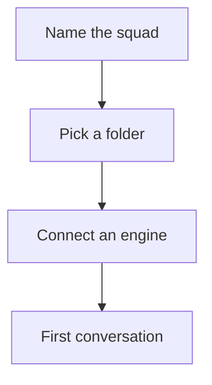

# Onboarding flow review

A long document for reading across the whole window. It has headings, a list,
a callout-style paragraph and a diagram, so focus view can be checked on
something that is more than one paragraph.

## What we found

- The first screen asks for the least: a name and a folder.
- The connection step explains what it does before it does it.
- The last step lands on the conversation, not on a settings page.

## How the steps connect

## What to change

Reading a long report beside a conversation leaves very little room. Opening it
across the window gives the text its own measure, and the way back is always the
first thing in the header.

### Details

1. Keep the steps in one place.
2. Say what each step does before it asks.
3. End on the work, not on a form.

Filler paragraph to make the page scroll: the quick brown fox jumps over the lazy dog, again and again, until the page is longer than the window is tall. The quick brown fox jumps over the lazy dog, again and again, until the page is longer than the window is tall.

The quick brown fox jumps over the lazy dog, again and again, until the page is longer than the window is tall. The quick brown fox jumps over the lazy dog, again and again, until the page is longer than the window is tall.

## Closing

That is all. The end of the document.
