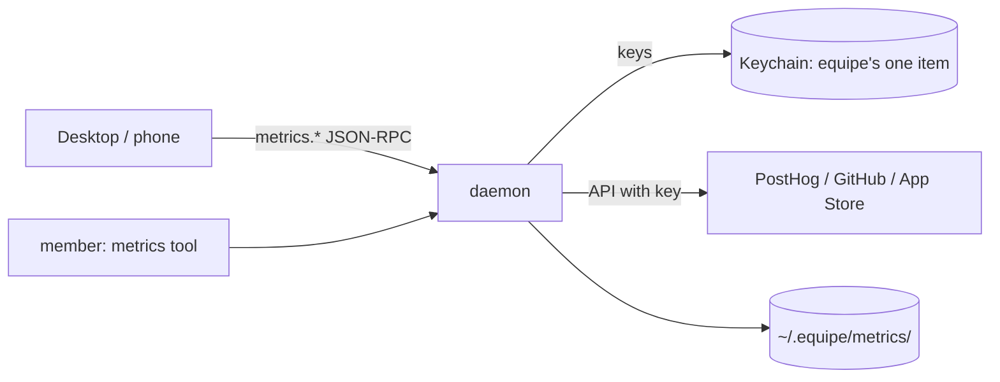

# Metrics

A maker connects the services their product reports to — PostHog, GitHub, App
Store Connect — and the squad and the person read the numbers inside equipe:
the desktop's Metrics screen in full, the phone as a summary card, the PM
through its `metrics` tool for the morning report and experiment calls.

There is no equipe server in it. **The daemon on the person's Mac calls each
service's API itself**, keeps the keys in that Mac's Keychain, and keeps what
it hears as daily snapshots under `~/.equipe/metrics/`. A screen on another Mac
or the phone gets numbers from that daemon, never keys.

Code: `crates/protocol/src/metrics.rs` (the wire types), `crates/core/src/metrics/`
(storage, fetches, periods, the tool), the requests in `crates/core/src/gateway.rs`.
Screens: `design/specs/metrics/` (T-311).



## Rules

- A key is in the Keychain and nowhere else: not `connections.json`, not a
  snapshot, not the daemon's log, not an answer, not a member's tool result.
  `metrics.connect` is the only message that carries one, inward.
- The keys live in equipe's one Keychain item (service `equipe`, account
  `secrets`, `crate::keychain`), beside logins' passwords, under
  `equipe.metrics:<connection id>`; items an older equipe kept per connection
  are moved into it when first read. The daemon reads the item once, at
  start, and keeps it in memory: one Keychain dialog at most, never one per
  connection, never one per fetch.
- The item trusts the `equipe` that made it by its code signature. An ad-hoc
  build (cdhash only) is a stranger to the next one — `errSecAuthFailed` or a
  dialog, error code `keychain` (T-356). Release builds are signed with the
  Developer ID (docs/RELEASING.md), so "Always Allow" lasts across updates.
  After a no, background fetches don't ask again for a day.
- An adapter's error message has every key of its connection cut out
  (`•••`) before it is kept, answered or logged — in case a service echoes it.
- Members only read. Connecting, keys and disconnecting are the person's, on
  their screen.
- Files under `~/.equipe/metrics/` are the person's only (folder 0700, files 0600).

## Sources

A **source kind** is a service. A **connection** is one source set up for a
squad, for one of its projects (`project`) or the squad as a whole (none).
A squad may have several connections of a kind (two GitHub repositories).

`metrics.sources` lists the kinds there are (`SourceSpec`): their fields and
the metrics they report. A screen builds its connect form from it — it doesn't
hard-code fields. A kind is offered only once its adapter exists.

| kind | status | fields (`*` secret, kept in the Keychain) | metrics |
|---|---|---|---|
| `fake` | here (tests, screens; offered when `EQUIPE_METRICS_FAKE` is set) | `token`*, `seed`, `fail` | `visits`, `stars`, `languages` |
| `posthog` | here (`adapters/posthog.rs`) | `api_key`* (Query: Read), `project_id`, `host` (default `https://us.posthog.com`), `filter`, `language_property`, `click_events`, `click_property`, `north_star_event`, `north_star_property`, `north_star_where` | `visits`, `languages`, `referrers`, `utm_sources`, `clicks`, `north_star` |
| `github` | here (`adapters/github.rs`) | `token`* (Administration: read), `repo` (`owner/name`) | `views`, `visitors`, `clones`, `stars`, `referrers` |
| `app_store` | here (`adapters/app_store.rs`) | `issuer_id`, `key_id`, `private_key`* (the .p8's text), `vendor_number`, `app_id` | `downloads` |

Each adapter's `spec()` is the truth for its fields and metrics; the hints
there say where in the service each one is found.

- **PostHog** asks HogQL (`/api/projects/<id>/query/`), days cut by this Mac's
  time zone. `visits` is page loads, not people, on a site that gives each
  load a new person ID. `filter` (`internal!=true, environment=production`) is
  the person's to set, never guessed. A breakdown keeps a day's 30 biggest
  labels and adds the rest up as `(other)`. Without `click_events` no clicks
  are asked.
- **PostHog's `north_star`** is docs/TELEMETRY.md's North Star: the distinct
  `squad`s of `work_accepted` events with `by = person` in the 7 days up to
  each day (`rolling`). `north_star_event` (default `work_accepted`),
  `north_star_property` (default `squad`) and `north_star_where` (default
  `by=person`, written like `filter`) change what is counted; `filter` isn't
  applied to it — those are the site's page loads' properties. One HogQL query
  a fetch counts every day (each day and squad seen stands for the 7 days
  whose window it is in), asking 91 days at most (12 windows of 7 and the one
  before), 14 later. A day before the first squad seen is left out (unknown);
  after it, a day with none is 0. With no event at all and none named (a
  maker's product doesn't send equipe's `work_accepted`), it isn't reported
  and the screen shows "no definition"; a named event with none is 0.
- **GitHub** traffic (`views`, `visitors`, `clones`) is the API's last 14
  days (`keeps_days` 14); `stars` is a day's running total from the
  stargazers' dates when they fit in 10 pages (1,000), else today's count
  only. `referrers` is GitHub's 14-day window, so it is a `total` split
  by label: a period shows its last day's split, not a sum of overlapping
  windows.
- **App Store Connect** reads the daily Sales report (`/v1/salesReports`,
  a JWT signed with the .p8 on this Mac): `downloads` is first-time
  downloads of `app_id`. Today is never asked; a day Apple has no report for
  yet is left out, and only a day it says sold nothing is 0. Apple keeps
  daily reports about a year (`keeps_days` 365), so a first fetch asks a
  year at most.

`fake` makes up numbers that look like a small site's, the same for the same
`seed` and day, and — like GitHub — remembers 14 days. `fail` (`auth`,
`rate_limited`, `network`) makes every fetch fail, its message quoting the
token so the redaction can be tested.

### Field

```json
{ "key": "api_key", "label": "Personal API key", "secret": true, "required": true, "hint": "PostHog → Settings → Personal API keys" }
```

`label` is English; screens translate by `key`.

## Metrics

Each source reports metrics by **name** (unique within the source), with a
**unit** and a **shape**:

| shape | a day is | a period is |
|---|---|---|
| `count` | that day's count | the sum of its days |
| `total` | a running total that day (stars), maybe split by label | its last known day (and that day's split) |
| `breakdown` | that day's count, split by label (`breakdown`) | each label summed, biggest first |
| `rolling` | the distinct count of the 7 days up to that day (squads) | its last known day; `previous` is the day 7 days before it, and `series` 12 days 7 apart ending there (`previous_series` empty), whatever `days` and `bucket` |

Units: `page_loads`, `clicks`, `views`, `clones`, `stars`, `downloads`, `squads`. Screens
word them ("page loads"). PostHog gives each page load a new ID, so `visits` is
page loads, not people.

A day is the daemon machine's **local calendar day**, `YYYY-MM-DD`. A day a
service doesn't know yet (App Store reports a day late) is left out, never 0:
it shows as a gap, and `as_of` says the latest day known.

## Periods

A query is a period of `days` (1–366, default 7) ending `to` (default today),
beside the **previous period**: the same number of days just before it.
`bucket` cuts its series: `day`, or `week` (Monday to Sunday; the first and
last buckets are cut at the period's ends, and each is named by its first day).
The screens' "7 days / 30 days" are `days: 7` and `days: 30`.

`change` is `value − previous`; `change_pct` is that over `previous`, in percent,
rounded to 0.1, absent when there is no previous value or it is 0.

## Snapshots

The daemon fetches each connection

- right after `metrics.connect` (asking up to 400 days back on the first fetch;
  an adapter may ask less — PostHog's `north_star` 91);
- once a day from **07:00 local** (asking the last 14 days);
- after a failed fetch, again when the service said (`retry_at`) or an hour later;
- on `metrics.refresh`.

One fetch per connection at a time; a second ask waits for the first's numbers.

What a fetch brings is kept as that day's snapshot:

```
~/.equipe/metrics/
  connections.json                       every connection (no keys)
  <squad>/<connection id>/<YYYY-MM-DD>.json   one per day fetched; a later fetch that day replaces it
```

```json
{
  "schema": 1,
  "connection": "m1",
  "kind": "github",
  "fetched_at": 1793520000,
  "points": [
    { "metric": "views", "day": "2026-11-01", "value": 312 },
    { "metric": "languages", "day": "2026-11-01", "value": 120, "breakdown": { "English": 70, "日本語": 50 } }
  ]
}
```

Reading, the snapshots are taken in day order and a later snapshot's value of a
day wins. So a day GitHub has forgotten (it keeps traffic for 14 days) stays as
the last snapshot that had it. Disconnecting keeps a connection's snapshots
unless asked to `forget`.

`schema` is bumped when a snapshot's meaning changes; the daemon reads only
schemas up to its own. Only points of the source's metrics, of real days, none
after today, are kept.

## JSON-RPC

Requests over the daemon's socket (`docs/ARCHITECTURE.md`, `protocol::rpc`),
answered on their own task. None needs `hello` first; each names its `squad`.

### `metrics.sources`

`{ "squad": "acme", "project"?: "equipe-site" }` → `Sources`

```json
{
  "kinds": [ { "kind": "fake", "label": "Fake", "fields": [...], "metrics": [...], "keeps_days": 14 } ],
  "connections": [ {
    "id": "m1", "squad": "acme", "project": "equipe-site", "kind": "fake",
    "settings": { "seed": "3" }, "keys": ["token"], "connected_at": 1793400000,
    "last": { "at": 1793520000, "error": { "code": "auth", "message": "token ••• was refused" } },
    "last_ok": 1793433600
  } ]
}
```

`keys` names the secret fields kept — never their values. `last` is the latest
fetch (with `error` when it failed); `last_ok` when one last worked. A screen
shows "last value, dimmed, with its time" from `last_ok` when `last.error` is set.

### `metrics.connect`

`{ "squad", "project"?, "kind", "settings": { every field, secret ones included } }` → `Connection`

With `"id": "m1"` instead of `kind`: new settings or keys for that connection; a
secret field left out keeps its key, a setting left out keeps its value; an
optional (not required, not secret) setting sent as `""` is cleared. The
answer comes at once; the first fetch follows on its own — `metrics.sources`
or `metrics.refresh` shows when it has.

### `metrics.disconnect`

`{ "squad", "id", "forget"?: false }` → `{ "id" }`. Its keys leave the Keychain.

### `metrics.refresh`

`{ "squad", "project"?, "id"? }` → `Sources`, once every fetch asked for is done
(up to 90 s each). A failed fetch isn't an error of the request: it is in that
connection's `last.error`.

### `metrics.query`

`{ "squad", "project"?, "days"?: 7, "to"?: "YYYY-MM-DD", "bucket"?: "day" | "week", "connections"?: ["m1"], "metrics"?: ["visits"] }` → `QueryResult`

```json
{
  "from": "2026-10-27", "to": "2026-11-02", "previous_from": "2026-10-20", "previous_to": "2026-10-26",
  "days": 7, "bucket": "day",
  "values": [ {
    "connection": "m1", "kind": "posthog", "metric": "visits", "label": "Visits", "unit": "page_loads", "shape": "count",
    "value": 1284, "previous": 1187, "change": 97, "change_pct": 8.2,
    "as_of": "2026-11-02", "days_known": 7,
    "series": [ { "day": "2026-10-27", "value": 160 }, { "day": "2026-10-28", "value": null } ],
    "previous_series": [ ... ],
    "breakdown": [ { "label": "English", "value": 742, "previous": 700 } ]
  } ],
  "connections": [ ... ]
}
```

`value` is `null` when no day of the period has one. `breakdown` only for
`breakdown` metrics. A query reads the snapshots only — it never calls a
service nor reads a key.

### `metrics.summary`

`{ "squad", "project"? }` → `Summary`: the phone's card — the last 7 days
beside the 7 before, the first four metrics that aren't breakdowns, in the
order of the connections and their sources' metrics, but `north_star` first
(its tile: the last day's squads beside 7 days before).

```json
{
  "squad": "acme", "project": "equipe-site", "from": "2026-10-27", "to": "2026-11-02",
  "tiles": [ { "connection": "m1", "kind": "posthog", "metric": "visits", "label": "Visits", "unit": "page_loads",
               "value": 1284, "previous": 1187, "change_pct": 8.2, "as_of": "2026-11-02",
               "error": { "code": "auth", "message": "..." } } ],
  "updated_at": 1793520000
}
```

A tile's `error` is its connection's latest failed fetch: the value is the last
one kept. The phone asks it through the relay (`docs/remote-protocol.md`, "The
project's numbers"): `metrics.summary` is the only `metrics.*` a device may
ask; keys never go to the phone — the person reconnects on the Mac.

## Errors

A request that can't be answered is a JSON-RPC error:

| code | when |
|---|---|
| -32602 | params missing or wrong (`days` outside 1–366, a bad `to`, no squad) |
| -32601 | no such `metrics.*` method |
| -32010 | that kind can't be connected yet (no adapter) |
| -32011 | a required field is missing, or a field the kind doesn't have |
| -32012 | no such connection in that squad |
| -32013 | the Keychain refused to keep or remove the keys |
| -32014 | `~/.equipe/metrics/` couldn't be written |

A **fetch** that fails isn't a request error; it is kept on the connection as
`last.error`, `{ code, message, retry_at? }`:

| code | the screen says |
|---|---|
| `auth` | the key was refused or expired — put in a new one (`metrics.connect` with `id`) |
| `rate_limited` | the service said not now — tried again at `retry_at` |
| `network` | the service couldn't be reached, or didn't answer in 90 s |
| `bad_response` | the service answered something equipe couldn't read |
| `keychain` | the key couldn't be read from the Keychain |
| `other` | anything else |

## The members' tool

`metrics` (every member; read only): `{ project?, days?, to?, metric?, by_week? }`.
It answers in text — each connection with its latest fetch (or its failure),
each metric's value beside the previous period with the change, the days known,
a breakdown's top labels and the series. It reads the snapshots only; nothing
in it comes from the Keychain. With nothing connected it says the person
connects services in equipe's Metrics screen.

## Adding an adapter

One file per service: **`crates/core/src/metrics/adapters/<kind>.rs`**
(`posthog.rs`, `github.rs`, `app_store.rs`), implementing `adapters::Adapter`:

```rust
pub trait Adapter: Send + Sync {
    fn spec(&self) -> SourceSpec;                       // fields, metrics, keeps_days
    fn fetch<'a>(&'a self, fetch: Fetch<'a>) -> Fetching<'a>; // → Vec<Point> or FetchError
}
```

`Fetch` gives the settings, the keys (from the Keychain), today and how many
days back to ask for, and the daemon's HTTP client. Then, in
`adapters/mod.rs` only, its `pub mod` and its arm in `adapter()`. An adapter
sends its keys to its own service and nowhere else; it returns days it knows
(not zeros for days it doesn't) and maps the service's refusals to
`auth` / `rate_limited` (with `retry_at` from `Retry-After`) / `network` /
`bad_response`. Everything else — keys, snapshots, periods, comparisons,
redaction, the schedule — is `metrics`' own, so adapters on separate tickets
don't touch the same files beyond those two lines.

Tests: the fake adapter (`adapters/fake.rs`) drives connect → refresh → query
in `crates/core/src/metrics/tests.rs` and over the socket in
`crates/core/tests/gateway.rs`; both check that the key is in no file, answer
or tool result.
